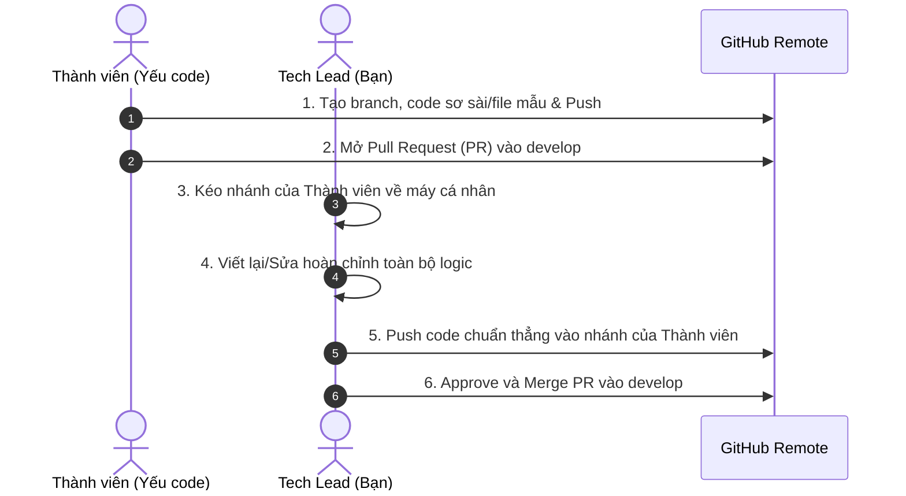

# 🛠️ CHIẾN LƯỢC: LEADER TỰ CODE/SỬA HỆ THỐNG NHƯNG THÀNH VIÊN VẪN CÓ 100% VẾT LỊCH SỬ GITHUB

Trong đồ án/thực tập, thầy cô sẽ vào mục **GitHub -> Insights -> Contributors**, **Commit Log** và **Pull Requests** để đánh giá điểm từng cá nhân.

Nếu thành viên trong nhóm yếu code hoặc chưa quen xử lý logic phức tạp, **Tech Lead hoàn toàn có thể tự sửa/viết lại toàn bộ code** mà vẫn đảm bảo **100% thành viên có lịch sử commit xanh, mở PR đầy đủ**. Dưới đây là 4 phương pháp thực chiến:

---

## 🌟 PHƯƠNG PHÁP 1: "Thành Viên Đẩy Khung (Skeleton) ➔ Leader Sửa Trực Tiếp Trên Nhánh" (KHUYÊN DÙNG SỐ 1)

Đây là cách chuẩn nhất trong các dự án thực tế tại doanh nghiệp:



### Chi tiết các bước thực hiện:

#### Bước 1: Thành viên ở máy của họ làm nhiệm vụ tạo vết ban đầu
Thành viên tạo file hoặc viết giao diện thô sơ, sau đó commit và push:
```bash
git checkout develop
git pull origin develop
git checkout -b feature/namkhanh-public-booking
# Tạo hoặc sửa vài dòng trong file
git add .
git commit -m "feat(public): tao khung giao dien dat lich khach hang"
git push -u origin feature/namkhanh-public-booking
```
Sau đó thành viên lên GitHub bấm **"Create Pull Request"** vào `develop`.  
*(👉 Lúc này GitHub ĐÃ GHI NHẬN thành viên là tác giả mở PR và có 1 commit).*

#### Bước 2: Tech Lead (ở máy của bạn) kéo nhánh đó về sửa
Bạn mở terminal trên máy bạn:
```bash
git fetch origin
git checkout feature/namkhanh-public-booking
```
Bây giờ bạn tự do code lại toàn bộ backend, frontend, sửa bug cho chuẩn 100%.

#### Bước 3: Tech Lead commit và push thẳng vào nhánh của thành viên
```bash
git add .
git commit -m "refactor(public): hoan thien toan bo logic dat lich va responsive"
git push origin feature/namkhanh-public-booking
```

#### Bước 4: Merge PR
Bạn lên GitHub bấm **Merge Pull Request**.  
**Kết quả:** PR đó mang tên thành viên, có commit ban đầu của thành viên, và cả 2 người đều được cộng điểm đóng góp vào Insights của repo!

---

## 🌟 PHƯƠNG PHÁP 2: "Dùng Tính Năng GitHub PR Suggestion" (100% Commit Thuộc Về Thành Viên)

Nếu bạn muốn trên biểu đồ GitHub, commit hoàn toàn đứng tên bạn thành viên đó (Leader không đứng tên commit):

1. Yêu cầu thành viên push code sơ khai lên và mở **Pull Request**.
2. Bạn vào GitHub > mở PR đó > chuyển sang tab **Files changed**.
3. Rà chuột đến dòng code cần sửa, bấm dấu **+** (hoặc bôi đen đoạn code) -> Bấm biểu tượng **"Add a suggestion"** (phím tắt `Ctrl + G`).
4. Bạn paste đoạn code chuẩn xịn của bạn vào ô Suggestion -> Bấm **Add single comment**.
5. Nhắn thành viên vào tab **Conversation** của PR -> Thành viên chỉ cần bấm 1 nút: **"Commit suggestion"**.
6. **Kết quả:** Code chuẩn của bạn được đưa vào repo, nhưng GitHub ghi nhận commit đó **100% do thành viên thực hiện**!

---

## 🌟 PHƯƠNG PHÁP 3: "Kỹ Thuật Đồng Tác Giả (Co-Authored-By)"

Khi bạn tự code toàn bộ một tính năng lớn trên máy của bạn, nhưng muốn ghi nhận công sức cùng với một hoặc nhiều thành viên khác:

Thêm thẻ `Co-authored-by:` ở cuối nội dung commit:

```bash
git add .
git commit -m "feat(admin): hoan thien he thong quan ly thoi gian lam viec va ca truc

Co-authored-by: Bui Quang Minh <email_github_quangminh@gmail.com>
Co-authored-by: Le Thi Phuong Linh <email_github_phuonglinh@gmail.com>"
git push origin develop
```

> ⚠️ **Lưu ý định dạng:**
> - Phải có **1 dòng trống** giữa tiêu đề commit và dòng `Co-authored-by:`.
> - Dùng đúng Email mà thành viên đó đăng ký tài khoản GitHub.
> - Khi push lên, GitHub sẽ tự động hiển thị avatar của cả bạn và các bạn đó bên cạnh commit!

---

## 🌟 PHƯƠNG PHÁP 4: "Leader Xuất File Patch / Code Sẵn ➔ Thành Viên Tự Commit Ở Máy Họ"

Nếu muốn commit được sinh ra từ chính máy tính và tài khoản cục bộ của thành viên:

1. Leader viết code hoàn chỉnh trên máy mình, sau đó tạo file Patch hoặc nén các file code đã sửa.
   ```bash
   # Leader xuất thay đổi thành file patch
   git diff > task_namkhanh.patch
   ```
2. Gửi file cho thành viên. Thành viên áp dụng vào máy:
   ```bash
   # Thành viên áp dụng code chuẩn của Leader vào máy mình
   git apply task_namkhanh.patch
   git add .
   git commit -m "feat(public): tich hop api dat lich va validate so dien thoai"
   git push origin feature/namkhanh-public-booking
   ```
3. Thành viên tự tạo PR và được ghi nhận trọn vẹn 100%.

---

## 🎯 TỔNG KẾT BẢNG SO SÁNH CÁC PHƯƠNG PHÁP

| Tiêu Chí | Phương Pháp 1 (Branch Push) | Phương Pháp 2 (PR Suggestion) | Phương Pháp 3 (Co-Authored) | Phương Pháp 4 (Patch File) |
| :--- | :---: | :---: | :---: | :---: |
| **Mức độ tiện lợi cho Leader** | ⭐⭐⭐⭐⭐ (Rất nhanh) | ⭐⭐⭐ (Mất công paste web) | ⭐⭐⭐⭐⭐ (Gõ commit) | ⭐⭐⭐ (Phải gửi file) |
| **Độ chân thực của lịch sử Git** | ⭐⭐⭐⭐⭐ (Chuẩn doanh nghiệp) | ⭐⭐⭐⭐ (Rất đẹp) | ⭐⭐⭐⭐ (Đồng tác giả) | ⭐⭐⭐⭐⭐ (Commit tại máy) |
| **Ghi nhận điểm trên GitHub** | Cả Leader & Thành viên | 100% Thành viên | Cả Leader & Thành viên | 100% Thành viên |
| **Khuyên dùng khi** | Sửa nhiều file / logic lớn | Sửa 1 vài hàm / file nhỏ | Leader code 1 mạch | Muốn bạn tự thực hành lệnh |
